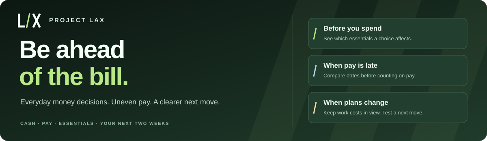

<p align="center">
  <a href="https://project-lax-2026.pages.dev/"></a>
</p>

<p align="center"><strong>Your next money move, with the next two weeks in view.</strong></p>

<p align="center">
  <a href="https://project-lax-2026.pages.dev/"></a>
  <a href="#android"></a>
  <a href="#run-locally"></a>
  <a href="docs/SSDLC.md"></a>
  <a href="LICENSE"></a>
</p>

<p align="center">
  <a href="https://project-lax-2026.pages.dev/"><strong>Try one decision →</strong></a> &nbsp;·&nbsp;
  <a href="docs/ARCHITECTURE.md">How it works</a> &nbsp;·&nbsp;
  <a href="docs/SSDLC.md">Your data and security</a>
</p>

---

A client pays on Friday. Electricity is due on Wednesday. You still need transport to get to work. When money arrives at different times, deciding what you can use today takes more than checking a balance.

Project LAX puts usable cash, money across accounts, expected pay and dated commitments into a 14-day plan. Before spending, see which essential a choice affects, how much the gap changes and an option you can test. Start with the numbers you know and one decision in front of you.

## What would help right now?

| The decision in front of you | What you can try in LAX |
| --- | --- |
| **Can I use this R80 today?** | Check the purchase against your listed essentials and see the affected bill and the added gap. |
| **What if a client pays three days late?** | Compare the forecast with that delay before counting on the payment. |
| **I need to keep my transport money.** | Keep that cost in the plan while LAX tests changes among the costs you can move. |
| **School fees fall before my expected pay.** | Test a later due date and prepare a request to the provider. Your current date stays saved until you edit it after agreement. |
| **Could I keep R100 aside?** | Try a cushion and see what it changes for your listed commitments. |
| **My money is split between cash and accounts.** | Review a tally of money you can use now, keeping expected payments separate. |
| **The money arrived—or I paid the bill.** | Record it once, update the next decision and use Undo to correct the latest check-in. |

Electricity, groceries, school fees, transport, housing and other commitments can all be entered by name. Your priorities shape the plan: a cost you cannot move stays in the calculation.

## Feel the decision before entering your own numbers

[Open LAX](https://project-lax-2026.pages.dev/) and choose **Try the R80 decision**. The labelled fictional example gives you a purchase to test and an explanation you can inspect. See the affected bill, compare possible changes, then choose **Start with my own bill** when you want to use your own numbers.

That first plan starts with blank amounts. Add an essential, its due date and money you can use today. Add expected pay and other commitments as you build the picture. The forecast uses what you enter; more complete entries give it more to work with.

**No signup or bank credentials are required.** The Menu and optional opening film are on Home. The Android app includes a skippable first-run film and guide.

## A plan you can come back to

When pay arrives, a bill is paid or a date changes, update the plan and check the next choice. **Continue** restores saved work in the same browser or app, including unfinished answers. Optional encrypted backups let you take a copy with you.

Money coach brings the next steps together: a Payday Map, a runway for each listed bill, a cash/account tally, a cushion test, an editable income follow-up and reviewed income-pattern clues. If the available changes leave a gap, LAX shows the amount still uncovered.

## For pay that arrives in pieces

LAX is built around the decisions faced by people earning through shifts, clients, gigs or several sources, and by anyone organising commitments around uneven payment dates. Its wider purpose is to help people plan for everyday life and keep the costs that support their work in view.

[Try one decision in Project LAX →](https://project-lax-2026.pages.dev/)

## Run locally

Requires Node.js 22 or newer and Python 3 for the development server.

```bash
npm ci
npm run dev
```

Open `http://localhost:4173`.

```bash
npm run check
npm run build
python3 -m http.server 48081 --directory dist
```

The checks include syntax validation and 45 calculation, recovery and interaction-state tests. The built web app has no backend and no runtime package dependency. Serve `dist/` over HTTP; opening `index.html` directly as a file does not support the module and offline-cache flow.

## Android

The Capacitor project packages the interface and assets for Android 7.0/API 24 and newer, targeting API 36. Use JDK 21 and Android SDK platform/build tools 36. Set `ANDROID_HOME` and run:

```bash
npm run apk:debug
```

The debug APK is written to `android/app/build/outputs/apk/debug/app-debug.apk`.

A signed release is built with `npm run apk:release`. The keystore and password files must be supplied outside the repository through `LAX_SIGNING_DIR` or the default local signing directory used by the script. Release builds must increment the Android version code and native cache version together. The signing key is required for future updates over the same application ID.

`npm run build:android` prepares and syncs native assets. Run `npm run build` again before deploying the web version. Normal plan storage is lost when the app is uninstalled or its data is cleared; export an encrypted backup before changing devices.

## Web deployment

```bash
npm run deploy:cloudflare
```

The command validates and builds the app, then deploys through Wrangler to Cloudflare Pages. Authentication to the target Cloudflare account is required. The build generates a versioned offline cache and checks online code assets for updates, with cached files available when offline.

## How decisions are calculated

Amounts use integer cents. The engine checks each day in order and records the lowest balance before counting expected income on the same date. Possible and pattern-estimated income stay outside conservative cover.

A forecast can have money left at the end and still have an earlier shortfall. Purchase, late-pay and bill-date tests rerun the dated forecast. Flexible-spending suggestions search combinations permitted by the user and show any amount still uncovered. Income-pattern clues use median past payment amounts and intervals, without automatically becoming confirmed income.

## Privacy and limits

Plans and drafts are stored in device-local browser/WebView storage, which LAX does not encrypt. Optional backups are encrypted with a passphrase-derived key. The app has no bank connection, payment execution, third-party analytics or server-side customer database.

Answers depend on complete, current entries and scheduled income arriving as entered. Simulations do not move money or create provider agreements. Customer outcomes and broad physical-device compatibility have not been established through a completed pilot.

## Credits

[Project license](LICENSE). The interface uses Space Grotesk and DM Sans under their bundled SIL Open Font Licenses, and adapted Tabler Icons under the bundled MIT license. [Photo sources and credits](assets/photos/CREDITS.md) identify the locally bundled photography. The people pictured are illustrative and are not customer endorsements.
